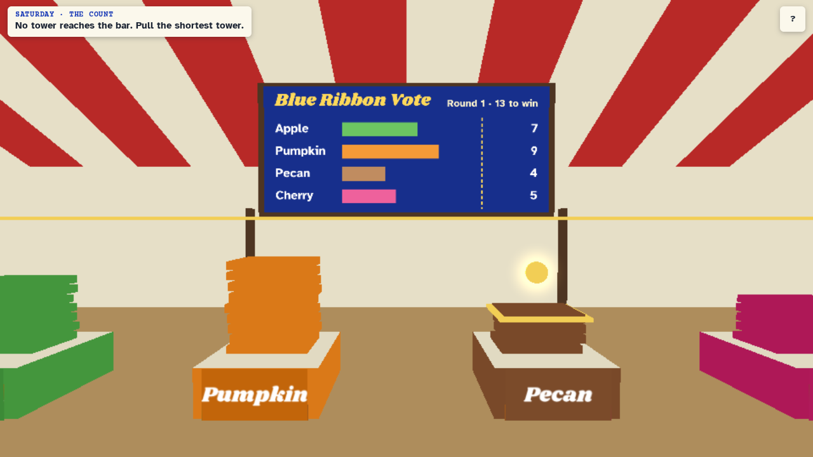

# Second Helping

A walkable 3D harvest fair that teaches ranked choice voting. Play it at https://second-helping.play.danielstephenson.dev, on desktop or a phone.



1. **The Count:** rank the pies at the voting booth, then count the ballots by hand. Pull the shortest tower and carry each ballot to its next pie still standing.
2. **The Spoiler:** hang the ribbon under the old one-mark rule, take Cherry off the ballot and watch the winner change, then predict the ranked count.
3. **The Doors:** you have three knocks to win second places for Aunt Dot's Pecan pie. Pecan starts third and needs 9 of 17.
4. **The Short Ballot:** count a vote where many neighbours ranked one pie. Spent ballots go in the crate, the win bar drops, and a recount with fuller ballots changes the winner.
5. **The Paradox:** switch two ballots to Apple first and find the pair that makes Apple lose.

## Run it

```sh
cd web && python3 -m http.server 8771 --bind 127.0.0.1
```

Then open http://localhost:8771/. Add `?economy=1` for the low-detail mode.

Keyboard: W A S D or arrows walk, Shift runs, drag to look, E uses, L opens the ledger. Touch: left stick walks, drag looks, tap the yellow button.

## Layout

| Path | What it holds |
| --- | --- |
| `web/rules.js` | The count and each day's logic, with no DOM or engine |
| `web/scene.js` | Fairground layout and geometry |
| `web/main.js` | Engine boot, input, HUD and story |
| `web/vendor/` | Strata 0.7.0 kit and the arcade hall's prebuilt engine and walking code, unmodified |

## Test it

```sh
node tests/rules.test.cjs
node tests/scene.test.cjs
node tests/play.cjs <screenshot-dir>   # needs the server running; plays all five days on desktop and phone sizes
```

`tests/play.cjs` needs Playwright (`npm i --no-save playwright` and `npx playwright install chromium`). Set `BASE` to test another address.

Any day can be picked from the title screen, and **Skip day** moves on during play. Neither touches the ledger.

## License

The game's own code is MIT, see [LICENSE](LICENSE). The files in `web/vendor/` keep their own licenses, listed in [web/vendor/README.md](web/vendor/README.md).
